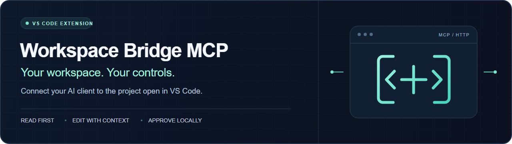
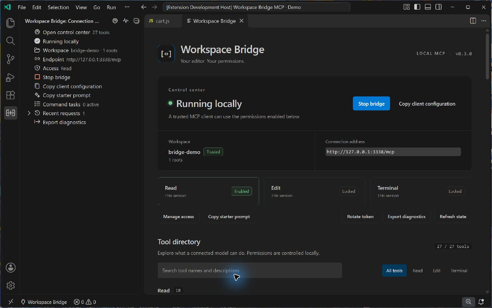
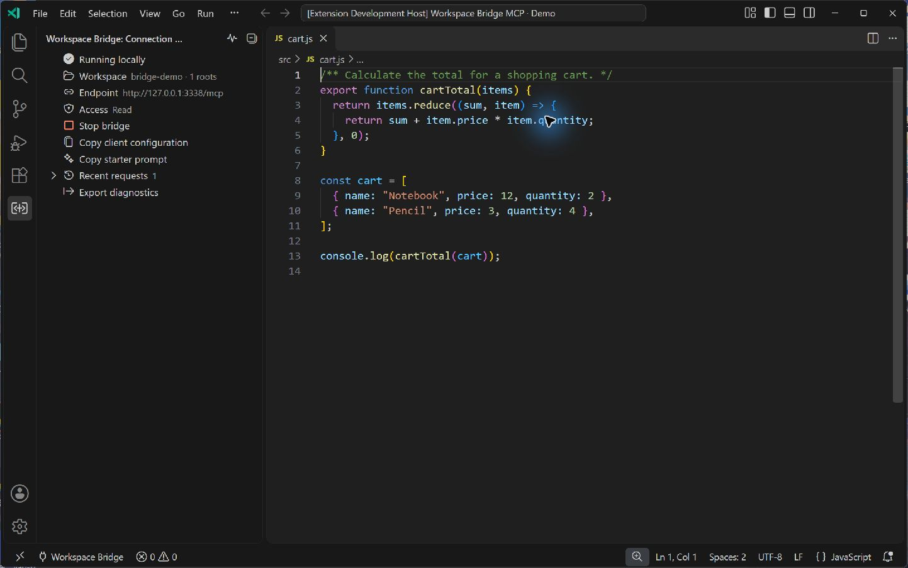
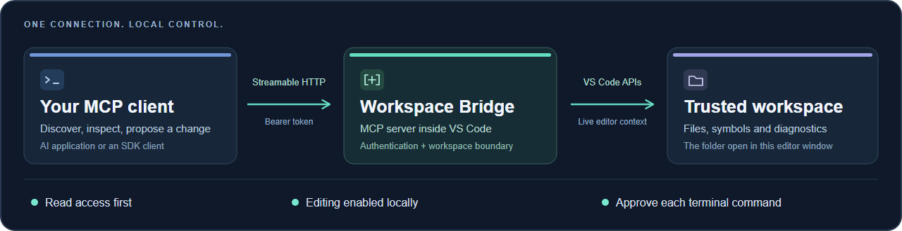

# Workspace Bridge MCP

<p align="center">
  
</p>

<p align="center">
  <a href="https://github.com/Yari-tuber/vscode-workspace-bridge-mcp/actions/workflows/ci.yml"></a>
  <a href="https://github.com/Yari-tuber/vscode-workspace-bridge-mcp/releases"></a>
  <a href="package.json"></a>
  <a href="LICENSE"></a>
</p>

<p align="center">
  <strong>English</strong> · <a href="README.zh-CN.md">简体中文</a><br />
  <a href="#start-in-three-steps">Get started</a> · <a href="docs/DASHBOARD.md">Control center</a> · <a href="docs/TOOLS.md">Tool reference</a> · <a href="docs/GETTING-STARTED.md">Setup guide</a> · <a href="SECURITY.md">Security</a>
</p>

**Give your AI client a practical workflow inside VS Code.** Read related files together, navigate symbols, prepare precise edits, organize text files, and follow approved command tasks—with access controlled in the editor.

Workspace Bridge is an **MCP server inside VS Code**. External MCP clients connect to it. VS Code's built-in MCP support goes in the other direction: it makes VS Code a client of other servers. You do not need to add this extension as a server inside VS Code to expose the workspace.

> **Connection requirement:** Streamable HTTP with a custom `Authorization: Bearer …` header. Bearer authentication is not OAuth; hosted connectors that require OAuth may be incompatible. The bridge does not create a public tunnel.



*Real v0.3.0 screenshot in an isolated development profile, with a synthetic demo workspace. No user project, credential or unrelated window is included.*

## One control center, from connection to completion

Open **Workspace Bridge: Open Control Center** from the Command Palette, the bridge sidebar, or the status bar. See the active workspace and permissions, search the **27-tool directory**, follow background tasks, cancel bridge-owned work, and inspect recent request metadata in one editor panel.

The control center supports English and Chinese, keyboard navigation, narrow editor groups, and the active VS Code theme. It never displays tokens, command text, or terminal output. **Copy client configuration** intentionally copies a token into your clipboard; use it only in a trusted client.

[Explore the control center →](docs/DASHBOARD.md)

<details>
<summary>Earlier interface: v0.2.0 native sidebar</summary>



*Real v0.2.0 screenshot from an isolated VS Code development profile and a synthetic sample project. The native sidebar remains available; this image predates the v0.3 control center. No token or personal project is shown. The banner and workflow illustrations are original project assets.*

</details>

## Start in three steps

1. **Install.** Download the `.vsix` from [Releases](https://github.com/Yari-tuber/vscode-workspace-bridge-mcp/releases/latest), verify its checksum, then choose **Extensions → … → Install from VSIX…** in VS Code.
2. **Start.** Open a trusted folder, open **Workspace Bridge** in the Activity Bar, and select **Open control center → Start bridge**. Confirm the workspace shown in the panel.
3. **Connect.** Select **Copy client configuration**, add it to a compatible MCP client, then use **Copy starter prompt** to begin with workspace discovery and reading.

The bridge starts with read access; editing and terminal execution stay off until you enable them locally. Each window has its own token. Connection configuration contains that secret—keep it in protected client settings, out of repositories and chat messages.

[Detailed installation, client configuration, and troubleshooting →](docs/GETTING-STARTED.md)

## Work with the editor's context

| Your goal | What the bridge provides |
| --- | --- |
| **Read a useful slice of the project** | Workspace discovery, safe file listing, literal search, and batch reads of up to ten related files—including unsaved editor changes and per-file hashes. |
| **Navigate the code** | Workspace and document symbols, definitions, type definitions, implementations, references, hover, diagnostics, and opening an allowed file for local review. Language features use installed providers. |
| **Make a precise change** | Local diff previews, hash-checked whole-file writes, range edits, and unique literal replacements. Range edits and replacements **preview by default**. |
| **Organize project text files** | Create safe directories, move one saved text file without overwriting, or send one file to Trash after local confirmation. No recursive deletion or permanent-delete fallback. |
| **Run and follow a check** | Short foreground commands or named background tasks with status polling, optional bounded output, and cancellation. Enable access locally and approve every command. |
| **Stay in control** | A theme-aware control center with searchable tools, permission states, owned tasks, request metadata, connection copying, token rotation, and local diagnostics export. |

The server exposes **27 tools** and the `review_workspace` prompt. v0.3 adds batch reading, wider code navigation, text-file lifecycle tools, and asynchronous command tasks. The [tool reference](docs/TOOLS.md) documents exact arguments and limits. Active selection text and background-task output are returned only when explicitly requested.

<p align="center">
  
</p>

## Permissions you can see

| Capability | Initial state | Local control |
| --- | --- | --- |
| Read allowed files and editor context | Available when the bridge runs in a trusted workspace | Stop the bridge to end access. File tools enforce the selected workspace boundary and filtering. |
| Preview edits, save, create directories, move or trash text files | **Off** | Enable editing for this session. Existing-file changes need the current SHA-256; moving/trashing also rejects unsaved changes. Each Trash operation requires local confirmation. |
| Execute a terminal command | **Off** | Enable terminal access, then approve **each command** and its working directory. |
| Reach the bridge remotely | Loopback listener only | Configure your own HTTPS forwarding and allowed hostname. See [remote access](docs/REMOTE-ACCESS.md). |

Stopping the bridge or changing workspaces resets editing and terminal grants. Reloading a window creates a new token; rotation revokes the old one immediately. Use the configuration from the intended window and rediscover its workspace before making changes.

Background tasks are session-only: at most three can await approval, run, or stop at once. A task ID or `awaiting_approval` response is not completion. Poll its state, inspect the final result, and remember that cancellation or failure does not undo effects the command already produced.

**Approved terminal commands use your operating-system account; they are not sandboxed.** They can access files outside the workspace and use the network.

## Connect a client

Copy the actual configuration from the running panel. This example illustrates the connection shape; client schemas differ:

```json
{
  "mcpServers": {
    "workspace-bridge": {
      "type": "http",
      "url": "http://127.0.0.1:<PORT>/mcp",
      "headers": { "Authorization": "Bearer <TOKEN>" }
    }
  }
}
```

`<PORT>` and `<TOKEN>` are placeholders. A stdio-only client needs its own HTTP adapter. Remote clients need a user-managed HTTPS route; this release has no OAuth authorization server, automatic tunnel, or multi-window router.

Try a first request such as:

> Discover the current workspace, then read its README and current diagnostics. Summarize what you found with file references. Do not change files or run terminal commands.

## Privacy, with explicit limits

- **Local by default.** Loopback binding, bearer authentication, VS Code SecretStorage, and no telemetry. Copying the configuration intentionally places a token on the clipboard and in your chosen client.
- **Constrained file tools.** Relative paths, real-path checks, link rejection, sensitive-name/content filtering, and bounded results. Filters cannot recognize every secret or provide operating-system isolation.
- **Minimal bridge records.** The control center, activity logs, and exported bridge diagnostics omit file contents, command text, terminal output, tokens, and user absolute paths. Requested file, language-service, and command results still go to the client and follow its retention policies.

Read the [security policy](SECURITY.md), [threat model](docs/THREAT-MODEL.md), and [audit notes](docs/SECURITY-AUDIT.md) before exposing an endpoint or enabling terminal access. Passing tests and scans do not prove that every vulnerability is absent.

## Verification and compatibility

The release workflow checks builds, unit tests, packaging, and privacy on **Windows, macOS, and Linux**. Real editor integration has also been exercised in isolated **Windows and Linux** environments. See [validation evidence](docs/VALIDATION.md) and the [CI run](https://github.com/Yari-tuber/vscode-workspace-bridge-mcp/actions/workflows/ci.yml) for the exact release scope.

Requires **VS Code 1.96+**. WSL, SSH, containers, and other remote extension hosts need separate acceptance; “local” means the machine running the extension host. Client compatibility depends on transport and authentication support, not the client's brand.

## Build and contribute

Requires **Node.js 22+**:

```sh
git clone https://github.com/Yari-tuber/vscode-workspace-bridge-mcp.git
cd vscode-workspace-bridge-mcp
npm ci
npm test
npm run privacy
npm run build
npm run test:integration
npm run package
```

Integration tests use a separate VS Code profile and temporary workspace. They download a test runtime unless `VSCODE_EXECUTABLE` selects an existing one. Use dummy data for development and acceptance.

| Resource | Purpose |
| --- | --- |
| [Setup & troubleshooting](docs/GETTING-STARTED.md) | Installation, settings, token lifecycle, and connection errors |
| [Control center](docs/DASHBOARD.md) | Searchable capabilities, permissions, owned tasks, and request metadata |
| [Tools & examples](docs/TOOLS.md) | Schemas, line conventions, editing workflow, and error handling |
| [Remote access](docs/REMOTE-ACCESS.md) | HTTPS forwarding, host validation, and remote environments |
| [Related projects & design notes](docs/RELATED-PROJECTS.md) | Comparable bridges, design references, and future work |
| [Contributing](CONTRIBUTING.md) · [Release notes](CHANGELOG.md) | Development expectations and changes |
| [Acknowledgements](docs/ACKNOWLEDGEMENTS.md) · [Third-party notices](THIRD_PARTY_NOTICES.md) | Upstream inspiration and dependency licenses |

Released under the [MIT license](LICENSE). This project does not imply endorsement by VS Code, MCP client vendors, or upstream projects.
