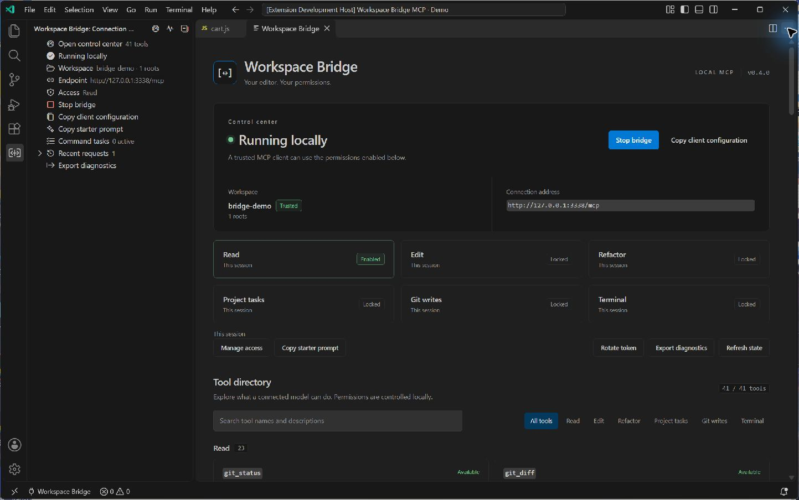

# Workspace Bridge MCP

<p align="center">
  
</p>

<p align="center">
  <a href="https://github.com/Yari-tuber/vscode-workspace-bridge-mcp/actions/workflows/ci.yml"></a>
  <a href="https://github.com/Yari-tuber/vscode-workspace-bridge-mcp/releases"></a>
  <a href="package.json"></a>
  <a href="LICENSE"></a>
</p>

<p align="center">
  <a href="README.md">English</a> · <strong>简体中文</strong><br />
  <a href="#三步开始使用">开始使用</a> · <a href="docs/DASHBOARD.md#中文说明">集中控制台</a> · <a href="docs/TOOLS.md">工具参考</a> · <a href="docs/GETTING-STARTED.md#中文上手指南">配置指南</a> · <a href="SECURITY.md">安全政策</a>
</p>

**让 AI 客户端在 VS Code 中完成更连贯的工作。** 批量读取关联文件、跟踪代码符号、准备精确修改、整理文本文件、跟进获批命令任务，访问权限由本地编辑器控制。

Workspace Bridge 是**运行在 VS Code 中的 MCP 服务端**，供外部 MCP 客户端连接。VS Code 内置 MCP 支持的方向相反：让 VS Code 作为客户端调用其他服务。要把当前工作区提供出去，无须再把本扩展配置成 VS Code 内部的 MCP 服务。

> **连接要求：**客户端支持 Streamable HTTP 和自定义 `Authorization: Bearer …` 请求头。Bearer 认证不等于 OAuth；强制要求 OAuth 的在线连接器可能不兼容。本扩展不会自动创建公网隧道。



*v0.4.0 隔离开发配置中的真实截图，使用虚构演示工作区，不包含个人项目、密钥或其他窗口内容。*

## v0.4：从修改代码到验证结果

新增 Git 状态、差异与提交；语义改名、格式化和仅文本快速修复；项目 npm 任务与保守的 TAP 测试摘要。共 **41 个工具**。

- **跨文件重构**：读取当前哈希后准备整组 Diff，再以短期编号申请本机确认。一次应用文本修改，保留未保存的编辑，方便你检查后保存。依赖已安装的语言服务。
- **Git 工作流**：查看状态和差异，确认后暂存或取消暂存；完整审阅暂存差异后才能提交。写入需独立权限，提交不运行仓库钩子、不签名、不自动推送。使用原始字节暂存，不执行 Git clean filters 或换行转换；需要这些功能时请在本地 Git 完成。
- **项目检查**：发现根目录 package.json 的 npm 脚本；本机选择一次执行或会话内允许同一任务。授权绑定整份清单，修改清单后重新确认；会话授权允许执行变化后的项目代码，因此仍拥有账户级文件和网络访问。
- **分级授权**：读取之外，文件修改、重构、项目任务、Git 写入和终端分别开启，可选 30 分钟、2 小时或当前会话，到期自动收回。
- **长任务**：后台任务最多运行 60 分钟，终端和项目任务合计最多 3 个。保留最近约 64 KB 日志并报告截断位置，日志过多不会停止任务；检测到疑似秘密后持续隐藏输出。

Git 当前支持元数据位于根目录内的普通仓库；外部 gitdir、linked worktree、子模块和部分特殊配置会保守拒绝。提交需要仓库本地 Git 身份配置；身份不返回给模型。测试摘要优先识别完整、一致的 Node TAP 汇总，其他输出明确标为 unknown。详见 [v0.4 使用与边界](docs/V4-WORKFLOWS.md)。

## 从连接到任务进度，一个控制台看清楚

在命令面板运行 **工作区桥接：打开控制台**，也可以从桥接侧栏或状态栏进入。当前工作区与权限、可搜索的 **41 个工具**、后台任务、取消桥接自身任务、最近请求元数据，都集中在一个编辑器面板里。

控制台支持中英文、键盘操作、窄窗口，以及当前 VS Code 主题。它不展示密钥、命令正文或终端输出。**复制客户端配置**会主动把密钥写入剪贴板，请仅粘贴到可信客户端。

[查看控制台使用说明 →](docs/DASHBOARD.md#中文说明)

<details>
<summary>早期界面：v0.2.0 原生侧栏</summary>


*v0.2.0 隔离开发配置中的真实截图，使用专门创建的演示项目。原生侧栏继续保留；此图早于 v0.3 集中控制台，不包含密钥或个人项目。顶部横幅和流程图均为项目原创素材。*

</details>

## 三步开始使用

1. **安装。** 从 [Releases](https://github.com/Yari-tuber/vscode-workspace-bridge-mcp/releases/latest) 下载 `.vsix`，核对 SHA-256，在 VS Code 选择 **扩展 → … → 从 VSIX 安装…**。
2. **启动。** 打开可信任的文件夹，在活动栏进入 **Workspace Bridge / 工作区桥接**，点击 **打开控制台 → 启动桥接**，确认面板显示的工作区。
3. **连接。** 点击 **复制客户端配置**，填入兼容的 MCP 客户端，再使用 **复制起步提示词**，先发现工作区并读取内容。

启动后默认允许读取；编辑和终端执行需要你在本地开启。每个窗口有独立 Token。连接配置包含这个秘密，请放入客户端受保护的设置，不要提交到仓库或粘贴进聊天。

[详细安装、客户端配置与故障排查 →](docs/GETTING-STARTED.md#中文上手指南)

## 用编辑器里的上下文完成工作

| 你想做的事 | 桥接提供的能力 |
| --- | --- |
| **读取关联代码** | 工作区发现、安全文件列表、字面搜索，一次读取最多十个关联文件；包含实时编辑内容与各自哈希。 |
| **定位实现与类型** | 工作区和文档符号、定义、类型定义、实现、引用、悬停、诊断，以及在本机打开允许的文件。语言能力使用已安装的服务。 |
| **精确修改** | 本地差异预览、SHA-256 冲突检查、全文写入、范围编辑和唯一字面文本替换。范围编辑与文本替换**默认只预览**。 |
| **整理项目文本文件** | 创建安全目录、移动已保存的单个文本文件且不覆盖目标，或逐个经本机确认移入回收站；不递归删除，也不降级为永久删除。 |
| **运行并跟进检查** | 短时前台命令或命名后台任务，支持状态查询、按需读取有界输出和取消；权限本地开启，命令逐条批准。 |
| **掌握当前状态** | 随主题适配的集中控制台，查看工具目录、权限状态、桥接任务和请求元数据；复制连接、轮换密钥、导出本地诊断。 |

服务提供 **41 个工具**和 `review_workspace` 提示词。v0.3 增加批量读取、更完整的代码导航、文本文件生命周期操作和异步命令任务。[工具参考](docs/TOOLS.md)列出准确参数与限制。选区正文与后台任务输出仅在明确请求时返回。

<p align="center">
  
</p>

## 权限清楚，操作可控

| 能力 | 初始状态 | 本地控制方式 |
| --- | --- | --- |
| 读取允许的文件与编辑器上下文 | 在可信工作区启动服务后可用 | 停止桥接即可结束访问；文件工具检查选定工作区边界并过滤敏感内容。 |
| 预览、保存、建目录、移动或回收文本文件 | **关闭** | 为当前会话开启编辑。已有文件操作需要当前 SHA-256；移动和回收还会拒绝未保存内容。每次回收均需本机确认。 |
| 执行终端命令 | **关闭** | 先开启终端权限，再对**每条命令**及其工作目录批准。 |
| 远程连接 | 仅监听本机回环地址 | 自行配置 HTTPS 转发和允许的主机名，见[远程访问](docs/REMOTE-ACCESS.md)。 |

停止服务或切换工作区会重置编辑和终端权限。重载窗口会生成新 Token；主动轮换会立即撤销旧 Token。请使用目标窗口的连接配置，并在修改前重新确认工作区。

后台任务仅在当前会话保留，等待确认、运行和停止中的任务合计最多三个。获得任务 ID 或返回 `awaiting_approval` 不代表完成；应继续查询并核对最终状态。取消或失败不会撤销命令已经产生的修改。

**获批终端命令使用你的操作系统账户权限，不在沙箱中运行。** 它可以访问工作区之外的文件，也可以联网。

## 连接客户端

从正在运行的面板复制实际配置。以下仅展示结构，不同客户端的配置格式可能不同：

```json
{
  "mcpServers": {
    "workspace-bridge": {
      "type": "http",
      "url": "http://127.0.0.1:<PORT>/mcp",
      "headers": { "Authorization": "Bearer <TOKEN>" }
    }
  }
}
```

`<PORT>`、`<TOKEN>` 是占位符。只支持 stdio 的客户端需要自行添加 HTTP 适配层。远程客户端需要自建 HTTPS 转发；本版本没有 OAuth 授权服务器、自动隧道或多窗口路由器。

可以这样发起第一轮请求：

> 先发现当前工作区，读取 README 并查看现有代码诊断。用文件位置说明你的发现。不要修改文件，也不要运行终端命令。

## 隐私保护与实际边界

- **默认留在本机。** 回环地址监听、Bearer 认证、VS Code SecretStorage，无遥测。主动复制配置会将 Token 写入剪贴板和所选客户端。
- **文件访问受限。** 相对路径、真实路径检查、链接拒绝、敏感文件名/内容过滤和结果大小限制；过滤无法识别所有秘密，也不提供操作系统隔离。
- **桥接记录尽量精简。** 控制台、活动日志和导出的桥接报告不含文件正文、命令正文、终端输出、Token 或用户绝对路径。按请求返回的文件、语言服务和命令结果仍会发给客户端，并受它的保留政策影响。

开放远程端点或启用终端前，请阅读[安全政策](SECURITY.md)、[威胁模型](docs/THREAT-MODEL.md)和[审计说明](docs/SECURITY-AUDIT.md)。扫描和测试通过不能证明完全没有漏洞。

## 验证范围与兼容性

发布流程在 **Windows、macOS、Linux** 上检查构建、单元测试、打包和隐私；另在隔离的 **Windows 与 Linux** 环境运行过真实编辑器集成检查。具体版本的证据以[验收记录](docs/VALIDATION.md)与 [CI 运行](https://github.com/Yari-tuber/vscode-workspace-bridge-mcp/actions/workflows/ci.yml)为准。

需要 **VS Code 1.96+**。WSL、SSH、容器及其他远程扩展宿主需单独验收；“本机”指实际运行扩展宿主的机器。客户端是否兼容取决于传输和认证能力，不能仅凭产品名称判断。

## 构建与参与贡献

需要 **Node.js 22+**：

```sh
git clone https://github.com/Yari-tuber/vscode-workspace-bridge-mcp.git
cd vscode-workspace-bridge-mcp
npm ci
npm test
npm run privacy
npm run build
npm run test:integration
npm run package
```

集成测试使用独立 VS Code 配置和临时工作区；未通过 `VSCODE_EXECUTABLE` 指定现有程序时，会下载测试运行时。开发与验收请使用虚构数据。

| 继续了解 | 内容 |
| --- | --- |
| [配置与故障排查](docs/GETTING-STARTED.md#中文上手指南) | 安装、设置、Token 生命周期和连接错误 |
| [集中控制台](docs/DASHBOARD.md#中文说明) | 搜索能力、管理权限、跟进桥接任务与请求记录 |
| [工具与示例](docs/TOOLS.md) | 参数、行号约定、编辑流程和错误处理 |
| [远程访问](docs/REMOTE-ACCESS.md) | HTTPS 转发、Host 校验和远程环境 |
| [相关项目与设计参考](docs/RELATED-PROJECTS.md) | 同类桥接、实现参考和后续方向 |
| [贡献指南](CONTRIBUTING.md) · [版本记录](CHANGELOG.md) | 开发约定与变更内容 |
| [项目致谢](docs/ACKNOWLEDGEMENTS.md) · [第三方声明](THIRD_PARTY_NOTICES.md) | 上游参考与依赖许可证 |

采用 [MIT 许可证](LICENSE)。本项目不代表 VS Code、MCP 客户端厂商或上游项目的背书。
