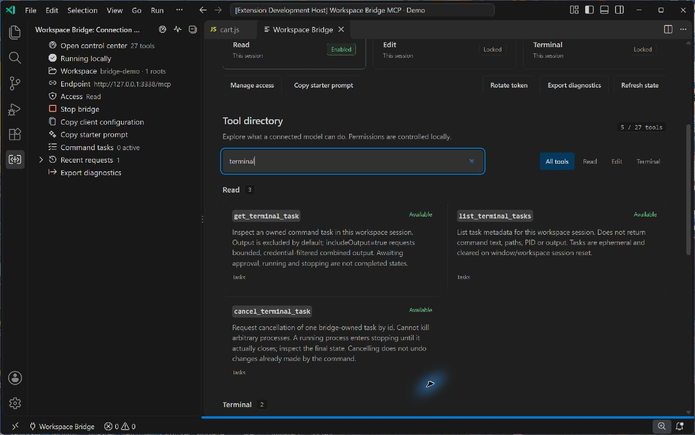

# Workspace Bridge control center

The control center keeps connection state, session permissions, the **41-tool directory**, background tasks, and recent activity in one VS Code editor panel. Its text follows the VS Code display language (English or Chinese), and its colors follow the active light, dark, or high contrast theme.

Open **Workspace Bridge: Open Control Center** (`workspaceBridge.openDashboard`) from the Command Palette, use **Open control center** in the bridge sidebar, or click the bridge status-bar item. The compact native sidebar remains available alongside the full control center.

## Connect a client

*Actual development-profile screenshot with synthetic sample data. The directory search and permission labels were checked in the running editor; no real commands or credentials are shown.*

1. Open a local folder or workspace and trust it in VS Code.
2. Choose **Start bridge**. Every new bridge session starts with read access only.
3. Choose **Copy client configuration** and paste it into a trusted MCP client. The copied configuration contains a bearer token, so keep it private.
4. Use **Copy starter prompt** for a suggested workflow, then let the model inspect the workspace before proposing changes.

The overview shows the workspace name, root count, trust state, local connection address, and current permissions. It does not display the token. This extension connects an MCP client to the editor; it does not include an AI model or provide a cloud connection.

## Understand and manage permissions

| Access | What the control center shows | How to change it |
| --- | --- | --- |
| Read | Whether workspace reading is available | Start or stop the bridge |
| Edit | Whether editing tools are unlocked | Choose **Manage access** for the current session |
| Terminal | Whether command tools are unlocked | Choose **Manage access**, then approve each command locally |

The searchable tool directory groups tools into **Read**, **Edit**, and **Terminal**. Locked tools remain visible so you can understand the available capabilities before enabling access. A tool appearing in the directory does not grant permission to use it.

The directory includes batch reading, workspace-symbol and type/implementation navigation, local file review, precise edits, directory creation, text-file moves and Trash, and command tasks. Open the [tool reference](TOOLS.md) for exact arguments and limits. Moving/trashing a file requires saved UTF-8 text and a current hash; each Trash operation also requires its own local confirmation.

Terminal commands run with your account permissions. They are not isolated in a process sandbox and can access the network or files outside the workspace when your account can. Each command still requires local approval.

## Follow background work

The task list shows only tasks owned by the bridge. It includes a safe task name, task ID, state, elapsed time, exit code when available, and whether the output limit was reached. It never shows the command, working directory, or output.

Choose **Cancel task** for a task awaiting local approval or currently running. Before forwarding cancellation, the extension checks the current host task list again to confirm the task belongs to the bridge and is still active. Stop and cancellation controls remain available while another local action, such as a permission dialog, is pending.

An awaiting approval, running, or **Stopping** row is still active. A stopping task cannot be cancelled again and continues to count toward the three-active-task limit until its owned child closes. Completion, failure, cancellation, timeout, and rejected approval are final states. Cancellation or failure never undoes file/network effects already produced by a command.

Background commands default to a 120-second execution timeout, with a 3,600-second maximum; local approval expires after 30 seconds. The session retains active tasks plus up to 20 finished tasks per kind (terminal or project). Stopping/resetting the bridge session clears that task history/output and requests termination of owned children. Model-facing output retrieval is separately opt-in with `includeOutput: true`, capped at 64,000 combined stdout/stderr bytes and filtered before returning; it is never displayed here.

Recent requests list the request time, tool name, status, and duration. No file contents, prompts, command bodies, request bodies, or terminal output are sent to this panel.

Use **Rotate token** when a copied credential must be replaced. Existing client configurations then need the new credential. **Export diagnostics** uses the extension's local export flow; it does not upload a report.

## Keyboard and layout

- Use **Tab** and **Shift+Tab** to reach every button, search field, and filter. Focus has a visible outline in all supported themes.
- Search by tool name, description, or category, and combine the search with the Read, Edit, or Terminal filters.
- The layout switches to one column in narrow editor groups. Tool cards and task metadata wrap; the request table can scroll horizontally.
- Status changes are announced through a polite live region. State is not conveyed by color alone.

## Security implementation

`src/dashboard.js` provides `createDashboard({ vscode, context, getState, onAction })`, returning `open()`, `update()`, and `dispose()`.

The webview is a static document. State is sent separately with `postMessage` after an allowlist projection, and all dynamic text uses `textContent`. Tokens, absolute workspace paths, file content, commands, and output are excluded from the state contract. An additional defensive check rejects common credential and private-path patterns in display fields; it supplements the metadata-only caller contract rather than replacing it.

The content security policy disables network connections and external resources. The single script and style block each require a newly generated nonce. Command URIs are disabled, local resource roots are empty, and the document contains no external links, iframes, images, or forms.

The extension accepts only these local actions: `start`, `stop`, `access`, `copyConnection`, `copyPrompt`, `rotateToken`, `exportDiagnostics`, and `cancelTask`. Only cancellation accepts a payload, with exactly one bounded string `id`. Unknown actions, additional fields, non-object messages, and messages over 4 KiB are rejected. The webview cannot provide an arbitrary VS Code command, URL, or HTTP request.

Unit tests in `test/dashboard.test.js` cover message validation, safe state projection, the CSP and script shape, task ownership checks, error redaction, out-of-order updates, and panel disposal. Real editor rendering and interaction should also be checked before a release.

---

## 中文说明

集中控制台把连接状态、当前会话权限、工具目录、后台任务和最近请求放在一个 VS Code 编辑器面板内，支持中英文以及浅色、深色和高对比度主题。

在命令面板运行 **工作区桥接：打开控制台**（`workspaceBridge.openDashboard`），或从桥接侧栏、状态栏进入。先启动只读会话，再把 **复制客户端配置** 得到的配置粘贴到可信 MCP 客户端。配置中含密钥，请勿公开。需要模型修改文件时，通过 **管理访问权限** 开启当前会话的修改权限；终端功能仍需逐条在本机确认命令。

工具目录包含 **41 个工具**，可搜索名称、说明和分类，也可按读取、修改、重构、项目任务、Git 写入和终端筛选。新增能力包括批量读取、工作区符号与类型/实现导航、在本机打开文件、安全建目录、移动和回收文本文件、异步命令任务。未开放的工具保留显示，并明确标注状态；可查看不等于已授权。

后台任务只展示桥接自身创建的任务，等待确认或运行中可取消。即使权限对话框仍在等待处理，停止桥接和取消任务也继续可用。**停止中**仍属活动状态，不能重复取消，在子进程关闭前继续占用三个活动名额之一。任务执行默认 120 秒、最长 3,600 秒，本机批准 30 秒后失效；历史保留活动任务与每类最多 20 个已结束任务（终端与项目任务分别保留）。会话重置会清空历史和输出并请求结束所属进程，取消或失败不会撤销已经产生的副作用。

控制台与最近请求均不展示命令、输出、文件正文、密钥或工作区绝对路径。模型若需要任务输出，须对具体任务明确请求 `includeOutput: true`；stdout/stderr 合并总计最多 64,000 字节，返回前经过过滤，控制台仍不显示该正文。

**更换密钥** 会使旧客户端凭据失效，随后需要更新客户端配置。**导出诊断** 调用本地导出流程，不会自动上传。面板支持键盘导航、明显的焦点边框和窄窗口布局；权限与任务状态均提供文字说明。
