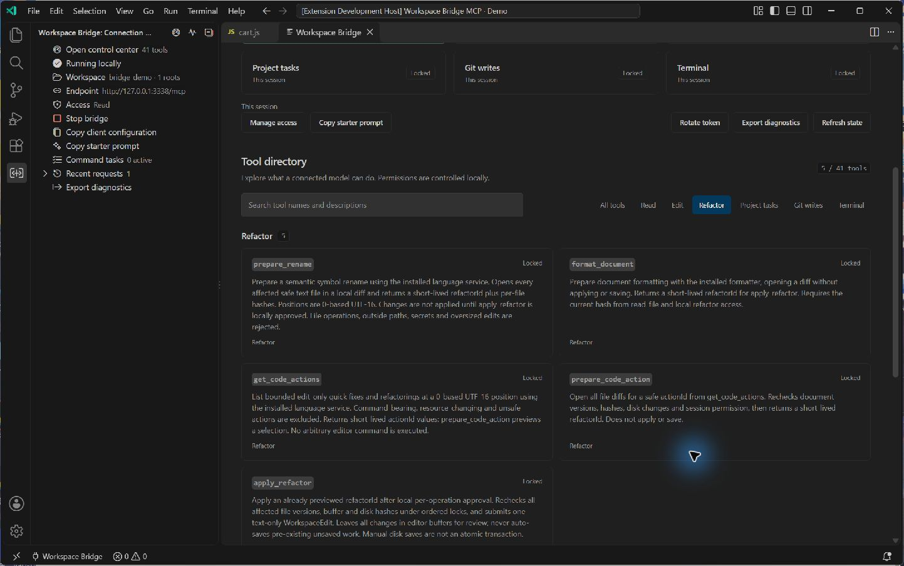

# v0.4 workflows / 使用指南

The controls are local to one VS Code window. They do not grant administrator access, isolate processes, or distinguish clients sharing the same bearer token. Use only trusted clients.

## Permissions / 权限

Open **Workspace Bridge: Open Control Center → Manage access**. Read access starts enabled; select edits, refactors, project tasks, Git writes and terminal commands independently. Choose 30 minutes, two hours, or the bridge session. Expiry revokes privileged access and cancels owned command tasks; stopping, rotation and workspace changes revoke the session. File and network effects already produced by a command are not undone.

在 **工作区桥接：打开控制台 → 管理访问权限** 中分别开启所需能力。读取外的五项权限可定时收回。Git、重构应用仍需逐次确认；任意终端命令始终逐次确认。相同 Token 的所有客户端共享这些窗口权限。

## Semantic changes / 语义修改

1. `workspace_overview`, then `read_file` for the current hash.
2. `prepare_rename` with a zero-based UTF-16 position and `newName`, or `format_document` with that hash.
3. Review every native Diff. `get_code_actions` lists edit-only actions; `prepare_code_action` previews one.
4. Call `apply_refactor` with its short-lived `refactorId`; approve the affected files locally.
5. Review the resulting unsaved buffers, save locally when ready, and inspect diagnostics or tests.

Plans expire after five minutes and are limited to 20 files, 50 text edits per file, and 2 MiB of proposed text. Buffer versions, content hashes and disk hashes must still match. Resource changes, commands and unknown provider edit representations are rejected. One editor text edit is applied; later disk saves are not an atomic transaction. Provider support varies by language and VS Code implementation.

中文：先读文件拿当前哈希，再预览跨文件改名、格式化或快速修复，最后申请应用。所有变更保留未保存，避免自动保存你原有的编辑。语言扩展不支持或预览过期时，需要重新准备。

## Git

1. `git_status` returns safe relative paths and `stateHash`. Inspect changed contents before staging.
2. `git_stage` or `git_unstage` names explicit files and uses `expectedStateHash`. Each write requires local approval.
3. `git_diff` with `staged: true` returns a `reviewHash` only for a complete, safe staged patch. Read the entire patch.
4. `git_commit` uses that `expectedReviewHash` and a message. The local dialog confirms the file list and message. An intervening change rejects the request.

Only self-contained repository roots are supported. Linked worktrees/external gitdirs, alternate object stores, config includes, special entries, and unreviewable staged content are restricted. Commit requires repository-local Git identity. User names/emails are not returned to the model. Staging stores raw bytes; clean filters and automatic line-ending conversion are bypassed. Commits are unsigned and skip hooks. No push, reset or clean tool is provided. Use local Git when your workflow depends on those integrations. Git must be installed.

中文：每次修改索引前检查状态指纹；提交前必须完整审阅暂存差异。需要 Git hooks、签名、LFS filters 或 linked worktree 的项目请使用本地 Git 完成相关操作，不能把本版当作完整 Git 客户端。

## Project tasks and test feedback / 项目任务与测试

`list_project_tasks` discovers script names and the hash of the root `package.json`. `run_project_task` requires that hash and separate project-task permission. Its local dialog shows the script and pre/post lifecycle scripts. Choose one run or allow the same task for this session. Manifest changes invalidate that approval. The latter option authorizes execution of changed project source too, with your account's filesystem and network privileges. It is not a process sandbox.

Use `get_project_task` until completion. A supported Node TAP summary returns test counts and bounded failing test names. Exit zero alone, empty tests, inconsistent summaries and unsupported reporters never become a claim that tests passed. Logs are excluded unless `includeOutput: true`; the retained log may omit earlier output. Reporters are project-controlled data, not independent verification.

中文：例如 package.json 的 test 脚本为 `node --test --test-reporter=tap`，模型可以运行后直接读取通过/失败数量和失败名称。其他测试框架先通过 npm 脚本运行；未识别的报告显示 unknown，并保留真实进程状态。先保存 package.json，再运行任务。

## Background jobs / 后台任务

`start_terminal_task` and project tasks share three active slots, including pending approval and stopping processes. The maximum is one hour; default task timeouts remain short. Recent output stays in a 64,000-byte UTF-8 rolling buffer with total bytes and starting offset. High output does not terminate the task. Suspected secrets or binary data cause output to stay withheld even after the original text rolls out. Poll task states; `awaiting_approval` and `running` are not success. Cancellation does not undo previous effects.

The bridge does not provide an interactive PTY, indefinitely running servers, automatic public tunnels or an OAuth server.
